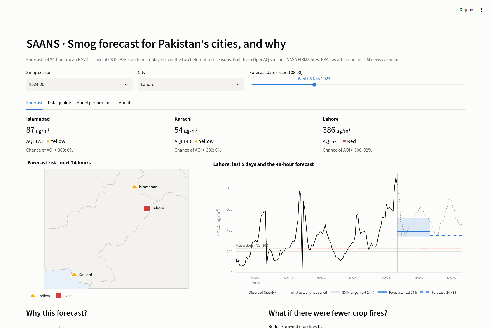

# SAANS: Smog Attribution And Nowcasting System

*Saans* means breath in Urdu.

SAANS forecasts PM2.5 for the next 24 and 48 hours in Lahore, Faisalabad, Multan, Islamabad and Karachi, warns of hazardous days (AQI above 300 on the US EPA scale), explains every forecast with SHAP, and turns it into English and Urdu health advice.

Data Science course project, SZABIST University Karachi. Farhan Bashir (2312407). Submitted to Sir Ahsan Nisar.

**Live dashboard:** https://saansgit-uhebsjzld3rfqxupnygsop.streamlit.app/ · **Final report:** [SAANS_Final_Report.docx](reports/SAANS_Final_Report.docx) · **Slides:** [SAANS_Presentation.pptx](reports/SAANS_Presentation.pptx)



## Where to find everything

**How the data was fetched and cleaned** (sources, API calls, date ranges, every cleaning step with counts): [`docs/DATA_PIPELINE.md`](docs/DATA_PIPELINE.md), also in the dashboard tab **How the data was made**.

| You are looking for | It is here |
|---|---|
| **Today's forecast** | Dashboard, tab **Live forecast** (from data fetched now); how it works: [notebook 07](notebooks/07_live_forecast.ipynb) |
| **The cleaning, step by step** | [notebook 02](notebooks/02_data_cleaning.ipynb): nine steps, each with its reason, rule and before/after counts |
| **The cleaned dataset** | [`data/processed/csv/`](data/processed/csv/): one CSV per city (opens in Excel); [`master_hourly.parquet`](data/processed/master_hourly.parquet); a one-week sample GitHub shows as a table: [`sample_lahore_1-7_nov_2024.csv`](data/processed/sample_lahore_1-7_nov_2024.csv); dashboard tab **Cleaned data** (filter and download) |
| **What every column means** | [`data/README.md`](data/README.md) |
| **Data Quality Report** (before/after statistics) | [`reports/data_quality_report.md`](reports/data_quality_report.md) (generated by notebook 02); dashboard tab **Data quality** |
| **Every data problem found, with evidence and fix** | [`reports/data_quality_log.md`](reports/data_quality_log.md) |
| **The LLM event calendar (JSON)** and its accuracy check | [`data/processed/events.json`](data/processed/events.json), [`reports/event_extraction_check.csv`](reports/event_extraction_check.csv), [notebook 03](notebooks/03_llm_event_calendar.ipynb) |
| **Trained models** and their evaluation against baselines | [`models/`](models/), [`reports/evaluation_regression.csv`](reports/evaluation_regression.csv), [`reports/evaluation_classifier.csv`](reports/evaluation_classifier.csv), [notebook 05](notebooks/05_models_shap.ipynb) |
| **Study notes / viva preparation** | [`docs/lessons/02-viva-guide.md`](docs/lessons/02-viva-guide.md) |

## Proposal checklist

| Proposal commitment | Delivered | Where |
|---|---|---|
| Ingestion scripts for the free sources, 2020-2025 | Yes: Open-Meteo, OpenAQ (PM2.5 and PM10), NASA FIRMS, GDELT news; 1 Jan 2020 to 31 Jan 2026 | `saans/ingest/`, notebook 01 |
| Clean 200,000+ raw records into one hourly master table | Yes: **2,048,724** raw records; 266,760-row hourly master table | notebook 02, `data/processed/` |
| Data Quality Report with before/after statistics | Yes, generated from the cleaning log, incl. sensors received/kept/rejected | `reports/data_quality_report.md` |
| The nine cleaning steps | Yes, all nine, plus dropout and zero-reading rules added after review | notebook 02 |
| PM2.5, PM10 and NO2 | PM2.5 and PM10 yes; **NO2 does not exist** in OpenAQ near these cities (0 sensors) | notebook 01, finding A10 |
| Forecast PM2.5 24 and 48 h ahead, five cities | Yes, on two held-out seasons **and live for today** | notebooks 05, 07; dashboard |
| Hazard classifier (AQI > 300) beating persistence | Yes: hit rate, false alarm ratio **and** false alarm rate, F1 | notebook 05 |
| Train 2020-23, test 2024 and 2025 seasons | Yes (training runs to Sep 2024; test seasons Oct-Jan never touched) | notebook 05 |
| UFI, stagnation index, lags, calendar features | Yes; UFI decay L tuned on training data (50 km) | notebook 04 |
| SHAP grouped into four driver categories | Yes | notebook 05; dashboard "Why this forecast?" |
| LLM event extraction, 20-record manual check | Yes: 425 events from 2,255 headlines; 65% fully correct on 20 | notebook 03 |
| AI Smog Explainer, English and Urdu, guardrails, cached | Yes: number check, template fallback, cache | notebook 06, `saans/advisory.py` |
| Streamlit dashboard: map, 48 h chart with band, "Why today?", what-if, advisory, data-quality tab | Yes, plus live mode and a cleaned-data browser | `app/streamlit_app.py` |
| Coverage map (uneven sensors, data equity) | Yes | notebook 01 `sensor_map.png`; dashboard Data quality tab |
| Final report and slides | Yes | `reports/` |
| Publish the cleaned dataset on Kaggle | Not done (needs the author's Kaggle account); the CSVs are ready in `data/processed/csv/` | |

## Results

Models trained on 1 Jan 2020 to 28 Sep 2024 and tested on two held-out smog seasons (October to January). Every number below is computed in [notebook 05](notebooks/05_models_shap.ipynb).

**Forecasting the next 24-hour mean PM2.5** (mean absolute error, ug/m3; lower is better)

| Test season | Cities | SAANS | Persistence | Seasonal average | Skill vs persistence |
|---|---|---|---|---|---|
| 2024-25, record season | Lahore, Islamabad, Karachi | **28.4** | 32.8 | 48.3 | **+13.4%** |
| 2025-26 | all five, incl. Faisalabad and Multan (never in training) | **25.4** | 26.1 | 68.4 | +2.7% |

The 48-hour forecast: 37.9 vs 44.2 (+14.3%) in 2024-25 and 36.0 vs 36.5 (+1.4%) in 2025-26.

* **Lahore, 2024-25:** +16% over persistence. On 6 Nov 2024, when schools closed in 18 districts, SAANS forecast 383 ug/m3 a day ahead (observed: 510).
* **Unseen cities:** Faisalabad +13%, Multan +11%, with no training data from either city.
* **Weak spot:** Lahore 2025-26 (-32%). After the US monitor feed stopped in March 2025, Lahore's data come from low-cost networks that read differently, and the model over-forecasts by about 25 ug/m3 ([finding L1](reports/data_quality_log.md)).

**Hazard warnings** (will the next 24 hours exceed AQI 300?)

| Test season | Method | Hit rate | False alarm ratio | False alarm rate | F1 |
|---|---|---|---|---|---|
| 2024-25 | SAANS classifier | **92.6%** | 33.5% | 10.1% | **0.774** |
| 2024-25 | Persistence | 75.5% | 24.4% | 5.3% | 0.755 |
| 2025-26 | SAANS classifier | **92.5%** | 33.9% | 12.2% | **0.771** |
| 2025-26 | Persistence | 75.8% | 23.6% | 6.0% | 0.761 |

SAANS warns of about 9 in 10 hazardous periods against 3 in 4 for persistence, at the cost of more false alarms, and 96% of those false alarms were still "Very Unhealthy" days (median 202 ug/m3).

**Other measured results:** weighting fires by wind direction raises the fire index's correlation with next-day PM2.5 from 0.29 to 0.38; boundary-layer-height imputation scores r = 0.91 on a hidden half-year; LLM event extraction is 65% fully correct on a hand-checked 20; the live code reproduces the training features exactly (0.0 difference over 266,760 rows).

**Live forecast, Sat 24 Oct 2026, 16:00 PKT** (next 24-hour mean, ug/m3): Lahore 75, Faisalabad 55, Multan 118, Islamabad 34, Karachi 42 (all Yellow except Islamabad, Green). NASA FIRMS did not answer during that run, so it was made without fresh fire data, as the dashboard states.

## The notebooks

| # | Notebook | What it does |
|---|---|---|
| 01 | [Data ingestion](notebooks/01_data_ingestion.ipynb) | What arrived from each source: sensor coverage and map, fires per month, headlines, raw record counts |
| 02 | [Data cleaning](notebooks/02_data_cleaning.ipynb) | The nine cleaning steps with before/after counts; writes the master table, CSVs and the Data Quality Report |
| 03 | [LLM event calendar](notebooks/03_llm_event_calendar.ipynb) | Gemini turns 2,255 headlines into 425 events; 20 checked by hand |
| 04 | [Features](notebooks/04_features.ipynb) | Upwind Fire Exposure Index, Stagnation Index, lags, calendar; no future information |
| 05 | [Models and SHAP](notebooks/05_models_shap.ipynb) | Baselines, LightGBM 24/48 h with an 80% band, hazard classifier, SHAP, what-if |
| 06 | [AI Smog Explainer](notebooks/06_llm_advisories.ipynb) | Bilingual advisories for every city-day: LLM for the key days (31, within the proposal's "few dozen calls"), template for the rest, all with the number guardrail |
| 07 | [Live forecast](notebooks/07_live_forecast.ipynb) | Parity check (live code = training code), then today's forecast from fresh data |

Every notebook has an "Open in Colab" button and runs there without API keys (the data, models and LLM answers are in the repository); only notebook 07 needs keys, because it fetches today's data.

## Run it yourself

```powershell
python -m venv $HOME\.venvs\saans                # outside OneDrive, so the environment is not synced
& $HOME\.venvs\saans\Scripts\Activate.ps1
pip install -r requirements.txt
copy .env.example .env                            # paste your API keys

jupyter notebook notebooks/                       # run 01 to 07 in order
streamlit run app/streamlit_app.py                # the dashboard

# optional: re-download everything (about 2 hours, mostly NASA FIRMS)
python -m saans.ingest.weather
python -m saans.ingest.openaq coverage; python -m saans.ingest.openaq hours; python -m saans.ingest.openaq pm10
python -m saans.ingest.firms
python -m saans.ingest.news
```

**Live mode on Streamlit Cloud:** app menu → Settings → Secrets, paste `OPENAQ_API_KEY`, `FIRMS_MAP_KEY`, `GEMINI_API_KEY`, `GROQ_API_KEY` as `NAME = "value"` lines. Without them the Live tab shows the latest committed snapshot, with its date.

## Repository layout

```
notebooks/        01-07, with outputs saved
saans/            ingest/ (downloaders), features.py, live.py, advisory.py, llm.py, aqi.py, viz.py, config.py
app/              Streamlit dashboard + its data (daily forecasts, advisories, live snapshot)
data/             interim/ parsed sources, processed/ cleaned data + CSVs, llm_cache/ (see data/README.md)
models/           trained LightGBM models and model card
reports/          Data Quality Report, findings log, evaluation tables, figures, final report, slides
docs/lessons/     study notes and viva guide
```
