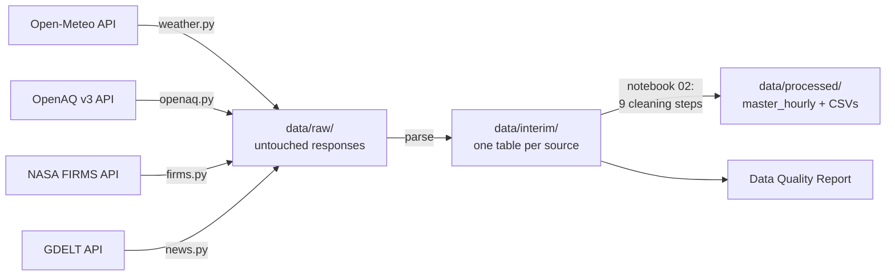

# How the SAANS data was fetched and cleaned

This page answers two questions in one place: **where every record came from and how it was downloaded**, and **what was done to clean it**. Every number is taken from the pipeline's own outputs ([Data Quality Report](../reports/data_quality_report.md), [findings log](../reports/data_quality_log.md)). The code is in [`saans/ingest/`](../saans/ingest/) (downloads) and [notebook 02](../notebooks/02_data_cleaning.ipynb) (cleaning); [notebook 01](../notebooks/01_data_ingestion.ipynb) shows each download step with real responses.



## 1. The study period, and why it ends on 31 January 2026

All historical data covers **1 January 2020 to 31 January 2026**. This comes from the proposal: data "covering 2020 to 2025", models "trained on the 2020 to 2023 seasons and tested on 2024 and 2025". A smog season runs **October to January**, so the 2025 season ends on 31 January 2026; stopping there gives two complete test seasons. February to September is outside the smog season.

Data after January 2026 is used by the **live forecast** (dashboard, Live tab; notebook 07), which downloads the last four days at the moment it runs. The download scripts take the period from one setting (`START_DATE`, `END_DATE` in [`saans/config.py`](../saans/config.py)), so the history can be extended by changing one line.

## 2. Where each source came from and how it was downloaded

All four downloaders follow the same pattern: request in small pieces, save **every response untouched** in `data/raw/`, skip pieces already saved (so an interrupted download resumes), respect the provider's rate limit, then parse everything into one table in `data/interim/`.

### Weather: Open-Meteo Historical Weather API (ERA5)

| | |
|---|---|
| Endpoint | `https://archive-api.open-meteo.com/v1/archive` (no key) |
| What | 13 hourly variables: temperature, humidity, dew point, rain, pressure, cloud, wind speed and direction at 10 m and 100 m, gusts, sunshine, **boundary layer height** |
| Where | One point per city (city centre coordinates in `saans/config.py`) |
| Request | `?latitude=31.5497&longitude=74.3436&start_date=2020-01-01&end_date=2020-12-31&hourly=temperature_2m,...&timezone=GMT&wind_speed_unit=ms` |
| Split | One request per city per calendar year: 5 cities x 7 years = **35 requests**, 5 s apart (free limit: 600 calls/minute) |
| Saved | `data/raw/open_meteo/<city>_<year>.json` (35 files) → `data/interim/weather_hourly.parquet` |
| Received | **266,760 hourly rows** (53,352 per city, every hour present) |
| Problem met | Boundary layer height is missing 1 Jan to 30 Jun 2024 in every model Open-Meteo serves (finding W1); imputed in cleaning |
| Command | `python -m saans.ingest.weather` |

### PM2.5 and PM10: OpenAQ API v3

| | |
|---|---|
| Endpoint | `https://api.openaq.org/v3/...` (free key, sent as the `X-API-Key` header) |
| Step 1: find sensors | `GET /v3/locations?coordinates=<lat>,<lon>&radius=25000` per city (25 km is the API maximum) → **248 sensors**, of which **200 PM2.5 sensors** overlap the study period; saved as `data/interim/openaq_sensors.csv` |
| Step 2: hourly values | `GET /v3/sensors/<id>/hours?datetime_from=<month start>&datetime_to=<month end>&limit=1000` |
| Split | **One month per request** (a month is at most 744 hours, so one page). Whole-year requests needed deep paging, which became slow (page 5 took 12 s) and timed out (HTTP 408) |
| Speed and limits | **1,274 requests** (1,269 sensor-months + 5 location searches). Free key: 60 requests/minute; four parallel workers paced on OpenAQ's rate-limit headers; HTTP 408/429/5xx and dropped connections are retried |
| Saved | `data/raw/openaq/hours/sensor_<id>.json` (205 files) → `data/interim/openaq_hourly.parquet` |
| Received | **587,969 PM2.5 sensor-hours** from 200 sensors; **5,904 PM10 sensor-hours** from the only 5 PM10 sensors; **NO2: no sensor exists** near any of the five cities |
| Commands | `python -m saans.ingest.openaq coverage`, `... hours`, `... pm10` |

**Sensor date ranges** (what is in the dataset, inside the study period):

| City | Network | Sensors | Hours | From | To |
|---|---|---|---|---|---|
| Lahore | US Embassy monitor (StateAir), reference | 1 | 41,304 | 1 Jan 2020 | 4 Mar 2025 |
| Lahore | Clarity | 1 | 15,542 | 28 Nov 2023 | 31 Jan 2026 |
| Lahore | AirGradient (low-cost) | 23 | 88,063 | 24 May 2025 | 31 Jan 2026 |
| Lahore | Hawanama (low-cost) | 49 | 43,680 | 18 Nov 2025 | 31 Jan 2026 |
| Islamabad | US Embassy monitor (StateAir), reference | 1 | 38,403 | 1 Jan 2020 | 4 Mar 2025 |
| Islamabad | Same monitor via AirNow, reference | 1 | 28,544 | 26 Aug 2021 | 31 Jan 2026 |
| Islamabad | AirGradient | 18 | 72,807 | 6 May 2025 | 31 Jan 2026 |
| Islamabad | Hawanama | 16 | 13,381 | 18 Nov 2025 | 31 Jan 2026 |
| Karachi | US Consulate monitor (AirNow), reference | 1 | 41,761 | 1 Jan 2020 | 4 Mar 2025 |
| Karachi | Clarity | 1 | 2,181 | 28 Nov 2023 | 28 Feb 2024 |
| Karachi | AirGradient | 23 | 68,097 | 2 Oct 2024 | 31 Jan 2026 |
| Karachi | Hawanama | 13 | 6,094 | 18 Nov 2025 | 31 Jan 2026 |
| Faisalabad | AirGradient | 29 | 94,427 | 23 Jun 2025 | 31 Jan 2026 |
| Faisalabad | Hawanama | 7 | 347 | 18 Nov 2025 | 31 Jan 2026 |
| Multan | AirGradient | 10 | 29,671 | 16 Jun 2025 | 31 Jan 2026 |
| Multan | Hawanama | 6 | 3,667 | 18 Nov 2025 | 31 Jan 2026 |

What this means: Lahore, Islamabad and Karachi have a continuous reference record from 2020 until the US monitor feed stopped on **4 March 2025**. Faisalabad and Multan have no data before **June 2025**. The low-cost networks (AirGradient, Hawanama) are still reporting today (24 Oct 2026), which is what the live forecast uses; the Islamabad AirNow feed ended on 16 Feb 2026 and the Lahore Clarity monitor on 31 Aug 2026.

### Fires: NASA FIRMS area API

| | |
|---|---|
| Endpoint | `https://firms.modaps.eosdis.nasa.gov/api/area/csv/<MAP_KEY>/<SOURCE>/66,24,78,34/<days>/<date>` (free MAP_KEY) |
| Area | 66-78 E, 24-34 N: Pakistani Punjab, Indian Punjab, Haryana, and Sindh down to Karachi |
| Sources | `VIIRS_SNPP_SP` (375 m pixels) and `MODIS_SP` (1 km), NASA's standard science-quality archive |
| Split | The API returns at most 5 days per call, so each month was fetched in 5-day chunks and saved as one CSV per month (73 months x 2 sources = **146 files**). Two workers per source, one walking forward from 2020 and one backward from 2026 |
| Limits | 5,000 transactions per 10 minutes per key. Above that, FIRMS answers "Invalid MAP_KEY" (observed at 4,886/5,000), so the downloader waits and retries |
| Time format | NASA stores time as an `HHMM` integer in UTC (`845` = 08:45), parsed into a timestamp |
| Saved | `data/raw/firms/<source>/<yyyy-mm>.csv` → `data/interim/firms_fires.parquet` |
| Received | **1,185,836 fire detections** |
| Dropped | VIIRS on NOAA-20 was also tried, but downloaded about 3 times slower (an estimated 5 hours), so it was left out |
| Command | `python -m saans.ingest.firms` |

### News: GDELT DOC 2.0 API

| | |
|---|---|
| Endpoint | `https://api.gdeltproject.org/api/v2/doc/doc?mode=artlist&format=json&maxrecords=250` (no key) |
| Query | `(smog OR AQI) (Lahore OR Punjab OR Multan OR Faisalabad OR Islamabad OR Karachi) sourcecountry:pakistan` |
| Split | Two windows per smog season (Oct-Nov, Dec-Jan), 13 requests |
| Limits | GDELT allows about one request per 5 seconds and throttled hard (HTTP 429); requests were spaced 10 s and retried after 30 s |
| Saved | `data/raw/gdelt/<window>.json` → `data/interim/news_headlines.csv` |
| Received | **2,438 articles**, **2,255** after removing duplicate links and near-identical headlines |
| Command | `python -m saans.ingest.news` |

**Total raw records received: 2,048,724** (weather 266,760 + PM2.5 587,969 + PM10 5,904 + fires 1,185,836 + headlines 2,255).

## 3. How it was cleaned (notebook 02)

Every cleaning action goes through one logging function, and that log becomes the [Data Quality Report](../reports/data_quality_report.md). The main counts:

| Step | Rule | Effect |
|---|---|---|
| 1. Time alignment | Every source stored in UTC, snapped to the hour; FIRMS `HHMM` parsed; Pakistan time added only for display and calendar features | 0 off-hour stamps; all sources on one hourly clock |
| 2. Units | All PM2.5 in ug/m3; AQI computed by us with the US EPA 2024 breakpoints (`saans/aqi.py`), never copied from websites | 243 sensors verified ug/m3 |
| 3. Duplicates and invalid values | One value per sensor-hour; nulls, negatives, readings below 1 ug/m3 (a faulting sensor's zero) and above 1,000 removed; an hour needs at least 75% of **that sensor's** usual number of readings | 25,555 nulls, 1,020 zero readings and 1,534 incomplete hours removed |
| 4. Sensor faults | Same value 6+ hours in a row = stuck sensor; repeated maximum = saturation | 216 stuck-sensor hours removed (e.g. Lahore's US monitor stuck at 67.0 for 105 hours) |
| 5. Glitch or real event | A spike more than 3x the neighbours within 5 km is a glitch; isolated spikes and sudden dropouts to near zero are glitches; fireworks nights protected; extremes kept and tagged `extreme_event` | 1,564 spikes and 1,114 + 6 dropouts removed |
| 6. Humidity correction | US EPA correction for low-cost sensors, applied **only where a pre-test check against a reference monitor shows it helps** | Applied to **no network**: it made AirGradient and Clarity worse, and Hawanama has no pre-test check. (A first version corrected Hawanama by default, which created a fake 40% drop in Lahore when that network switched on, 19 Nov 2025; found by an external review and fixed.) |
| 7. Fire cleaning | Low-confidence detections out; NASA's static industrial sources and offshore flares out; one fire per ~1 km cell, day and pass | 1,185,836 → 815,434 fires |
| 8. Missing values | City series = reference monitor if present, else median of low-cost sensors; gaps up to 3 h interpolated **outside the test seasons only**; longer gaps flagged; missing boundary layer height imputed and validated (r = 0.91) | 2,937 hours filled; 21,840 BLH values imputed |
| 9. Integration | Weather + PM2.5 + PM10 + fires within 300 km + event tags, one row per city per hour | **266,760-row master table**, 29 columns |

Sensors: 200 PM2.5 sensors received, **190 kept**, **10 rejected** (fewer than 24 valid hours left after cleaning).

## 4. Where the results are

* Cleaned table: [`data/processed/master_hourly.parquet`](../data/processed/master_hourly.parquet) and one CSV per city in [`data/processed/csv/`](../data/processed/csv/); column meanings in [`data/README.md`](../data/README.md)
* Every cleaning action with before/after counts: [`reports/data_quality_report.md`](../reports/data_quality_report.md)
* Every problem found and how it was handled: [`reports/data_quality_log.md`](../reports/data_quality_log.md)
* On the dashboard: tabs **How the data was made**, **Cleaned data** and **Data quality**

## 5. Reproduce it

```powershell
copy .env.example .env      # paste the OpenAQ and NASA FIRMS keys (Open-Meteo and GDELT need none)
python -m saans.ingest.weather
python -m saans.ingest.openaq coverage
python -m saans.ingest.openaq hours
python -m saans.ingest.openaq pm10
python -m saans.ingest.firms
python -m saans.ingest.news
jupyter notebook notebooks/02_data_cleaning.ipynb
```

A full re-download takes about two hours, mostly NASA FIRMS. Downloads resume where they stopped.
