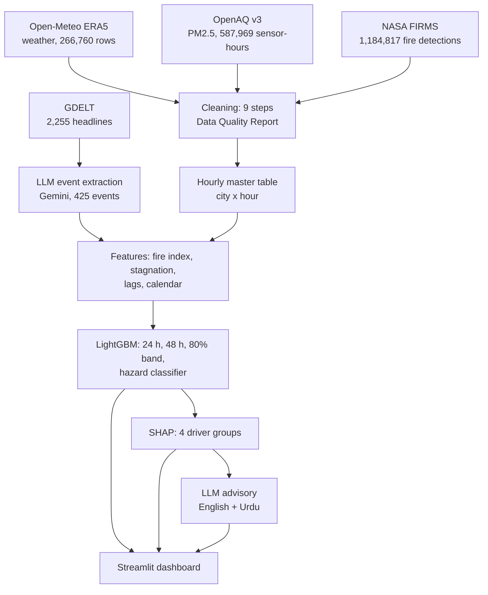

# Lesson 2: How SAANS works, and how to defend it

Read this once slowly, then use sections 3 and 4 as flash cards. Every number here comes from the notebooks.

## 1. The whole system in one picture

The LLM appears twice: at the start (turning news into data) and at the end (turning numbers into advice). In between, everything is classical data science.

## 2. Each stage in plain words

**Ingestion (notebook 01).** Four free APIs. Raw responses are saved untouched, then parsed into tables. The first check was coverage: the only long, reference-grade PM2.5 records are the US diplomatic-post monitors in Lahore, Islamabad and Karachi, and that feed stopped on 4 March 2025. Faisalabad and Multan only have low-cost sensors from June 2025.

**Cleaning (notebook 02).** Nine steps, each logged with before/after counts:
1. one clock (UTC) for every source;
2. units in ug/m3 and our own AQI (EPA 2024 breakpoints);
3. duplicates, nulls, negatives, impossible values, incomplete hours;
4. stuck sensors (same value 6+ hours) and sensors at their limit;
5. glitch vs real event (neighbours within 5 km; isolated spikes; fireworks nights protected);
6. humidity correction, applied only where a reference monitor proves it helps;
7. fire cleaning (low confidence, industrial heat sources, repeat satellite passes);
8. missing values (short gaps filled outside test seasons; BLH gap imputed and validated);
9. integration into one table, one row per city per hour.

**LLM event calendar (notebook 03).** Gemini reads headlines in batches and returns JSON events (type, place, date). The output is validated like any other data, and 20 random events were checked by hand: 65% fully correct.

**Features (notebook 04).** Four groups: recent pollution, weather (incl. Stagnation Index), upwind fires (UFI), calendar. Rule: nothing from the future.

**Models (notebook 05).** LightGBM predicts the change of the next 24-hour mean from the last 24 hours. Baselines: persistence and seasonal average. A classifier warns when the next 24 hours will exceed AQI 300. SHAP explains every forecast.

**Advisories (notebook 06).** Gemini writes three lines in English and Urdu from the model's numbers only; a script rejects any advisory containing a number we did not supply.

## 3. Numbers to remember

| What | Number |
|---|---|
| Raw records | ~2.04 million (weather 266,760; PM2.5 587,969; fires 1,184,817; headlines 2,255) |
| PM2.5 sensors | 200, within 25 km of the five cities |
| Train / test | train 1 Jan 2020 to 28 Sep 2024; test seasons Oct 2024-Jan 2025 and Oct 2025-Jan 2026 |
| 24 h skill vs persistence | +14.4% (2024-25), +1.6% (2025-26) |
| Lahore 2024-25 | +17%; record day 6 Nov 2024: forecast 386, observed 510 ug/m3 |
| Unseen cities | Faisalabad +14%, Multan +11% |
| Hazard hit rate | 92% vs 76% for persistence (F1 0.774 vs 0.755) |
| Fire index | L = 50 km; wind weighting raises correlation 0.30 to 0.38 |
| BLH imputation | r = 0.91 on a hidden half-year |
| LLM extraction | 425 events; 65% fully correct on 20 checked |
| Advisories | 32 of 32 passed the number check |

## 4. Likely questions, with answers

**Why split by time instead of randomly?**
The target is a 24-hour mean, so neighbouring hours overlap. A random split would put 10:00 in training and 11:00 in test: the model would effectively see the answer. Forecasting also means predicting the future, so the test must lie after the training period.

**What is the persistence baseline, and why must you beat it?**
"Tomorrow will look like the last 24 hours." It is free and surprisingly hard to beat for smog, which changes slowly. A model that cannot beat it adds nothing. SAANS beats it by 14% in the 2024-25 season.

**Why does SAANS predict the change rather than the level?**
Tree models cannot predict values outside the range they saw in training. The first version forecast 283 for a day that turned out to be 510. Predicting the change from the last 24 hours lets the forecast follow record levels (386 for that day) and cancels constant offsets between sensor networks.

**What is the Upwind Fire Exposure Index?**
For every fire seen 24 to 72 hours earlier: fire radiative power, times a distance decay e^(-d/L), times how directly the wind was blowing from the fire to the city (cos of the angle, zero if crosswind or downwind). L = 50 km was chosen on training data. Weighting by wind direction improved the correlation from 0.30 to 0.38, which supports the idea that smoke travels with the wind.

**What is SHAP?**
A method from game theory that splits one prediction into contributions from each feature, which add up exactly to the prediction. We sum them into four groups (recent pollution, weather, fires, calendar) for the "Why today?" panel. It explains what the model relied on; it is not a chemical measurement of sources.

**How did you stop the LLM from inventing numbers?**
It never predicts. It only receives our numbers and must reuse them exactly, and a script checks every number in its output (Urdu digits included) against the allowed list. Failures fall back to a fixed template. All answers are cached.

**65% extraction accuracy is low. Why use it?**
It is a strict score: type, place and date must all be supported by the headline. The errors are understandable (it missed "lift" and "reopen", and guessed places), and the events are a minor feature. Reporting the honest number is the point of the check; the fix (rules for "lift/reopen" headlines) is future work.

**Why did you not apply the humidity correction to all low-cost sensors?**
We tested it against a reference monitor first. AirGradient's data matched the reference raw (35.9 vs 34.0) but fell to 18.6 after correction, so AirGradient evidently publishes corrected data already. Correcting twice would have halved real values. The rule became: correct only where evidence shows it helps.

**Why did Lahore do badly in 2025-26?**
The US monitor feed stopped in March 2025, so Lahore's data switched to low-cost networks that read differently (Clarity reads 32% below the reference). The model, trained on the reference monitor, over-forecasts by about 26 ug/m3. It is a data-equity finding: losing a reference monitor makes forecasts worse.

**How did you handle missing data?**
Short PM2.5 gaps (up to 3 hours) were interpolated, only in training years; the test seasons were never filled, so scores use real measurements only. The six-month gap in boundary layer height was imputed with a model and checked on a half-year we hid on purpose (r = 0.91).

**What does "hit rate 92%, false alarm ratio 33%" mean?**
Of the hazardous periods that happened, 92% were warned. Of the warnings issued, 33% did not reach AQI 300, but they were not clean days: among the dashboard's daily 08:00 forecasts, 94% of false alarms were still "Very Unhealthy" (median 201 ug/m3). For public health, missing a hazardous day costs more than an extra warning, so the threshold (0.25) was tuned on validation data to favour warnings.

**Why is Karachi's skill zero?**
Karachi's air is cleaner and steadier (sea breeze, high boundary layer, far from the burning belt), so persistence is already very good there. There is little left to predict.

**What would you do with more time?**
Feed weather *forecasts* instead of only observed weather; recalibrate the low-cost networks against reference data; run SAANS live for the 2026 season; add Sentinel-5P satellite data for cities without sensors.

## 5. Demo script (2 minutes)

1. Open the dashboard. Season 2024-25, Lahore, 6 Nov 2024 (the default).
2. Map and tiles: "Lahore is red: forecast 386, AQI above 300."
3. Chart: black line is the last five days; the blue band is the 80% range; the dotted grey line is what actually happened.
4. "Why this forecast?": recent pollution and upwind fires push it up.
5. Slide the fire reduction to 100%: the forecast drops; explain it is a model estimate.
6. Advisory: read one English line, show the Urdu.
7. Switch to 2025-26 and Faisalabad: "a city the model never trained on."
8. Data quality tab: the cleaning report.
