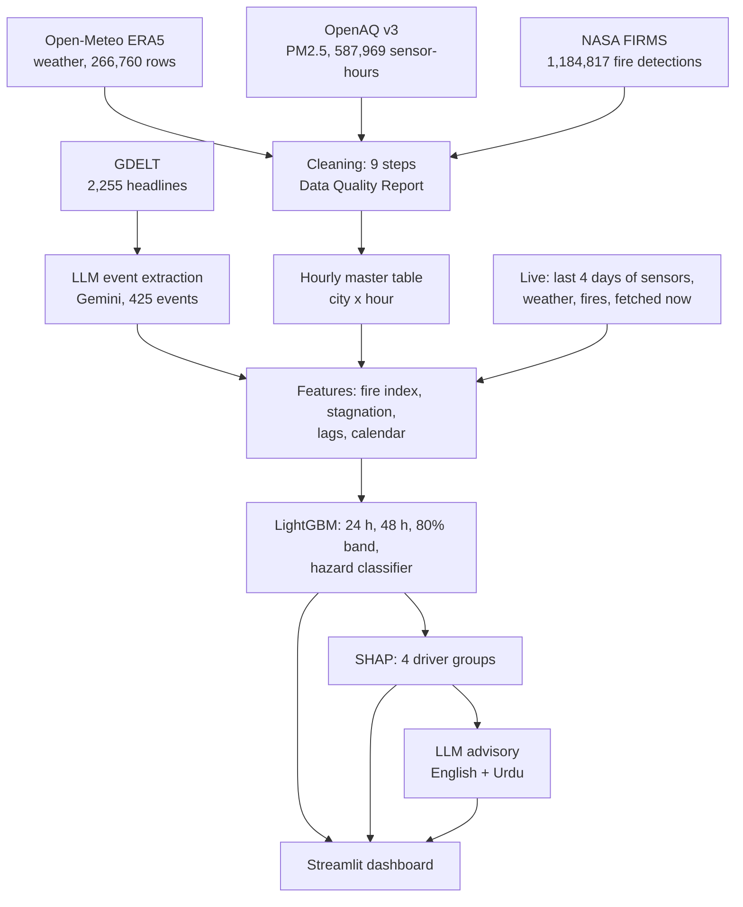

# Lesson 2: How SAANS works, and how to defend it

Read this once slowly, then use sections 3 and 4 as flash cards. Every number here comes from the notebooks.

## 1. The whole system in one picture

The LLM appears twice: at the start (turning news into data) and at the end (turning numbers into advice). In between, everything is classical data science.

## 2. Each stage in plain words

**Ingestion (notebook 01).** Four free APIs. Raw responses are saved untouched, then parsed into tables. The first check was coverage: the only long, reference-grade PM2.5 records are the US diplomatic-post monitors in Lahore, Islamabad and Karachi, and that feed stopped on 4 March 2025. Faisalabad and Multan only have low-cost sensors from June 2025.

**Cleaning (notebook 02).** Nine steps, each logged with before/after counts:
1. one clock (UTC) for every source;
2. units in ug/m3 and our own AQI (EPA 2024 breakpoints);
3. duplicates, nulls, negatives, impossible values, incomplete hours;
4. stuck sensors (same value 6+ hours) and sensors at their limit;
5. glitch vs real event (neighbours within 5 km; isolated spikes; fireworks nights protected);
6. humidity correction, applied only where a reference monitor proves it helps;
7. fire cleaning (low confidence, industrial heat sources, repeat satellite passes);
8. missing values (short gaps filled outside test seasons; BLH gap imputed and validated);
9. integration into one table, one row per city per hour.

**LLM event calendar (notebook 03).** Gemini reads headlines in batches and returns JSON events (type, place, date). The output is validated like any other data, and 20 random events were checked by hand: 65% fully correct.

**Features (notebook 04).** Four groups: recent pollution, weather (incl. Stagnation Index), upwind fires (UFI), calendar. Rule: nothing from the future.

**Models (notebook 05).** LightGBM predicts the change of the next 24-hour mean from the last 24 hours. Baselines: persistence and seasonal average. A classifier warns when the next 24 hours will exceed AQI 300. SHAP explains every forecast.

**Advisories (notebook 06).** Gemini writes three lines in English and Urdu from the model's numbers only; a script rejects any advisory containing a number we did not supply.

## 3. Numbers to remember

| What | Number |
|---|---|
| Raw records | 2,048,724 (weather 266,760; PM2.5 587,969; PM10 5,904; fires 1,185,836; headlines 2,255) |
| PM2.5 sensors | 200, within 25 km of the five cities |
| Train / test | train 1 Jan 2020 to 28 Sep 2024; test seasons Oct 2024-Jan 2025 and Oct 2025-Jan 2026 |
| 24 h skill vs persistence | +13.4% (2024-25), +2.7% (2025-26) |
| Lahore 2024-25 | +16%; record day 6 Nov 2024: forecast 383, observed 510 ug/m3 |
| Unseen cities | Faisalabad +13%, Multan +11% |
| Hazard hit rate | 92.6% vs 75.5% for persistence (F1 0.774 vs 0.755); false alarm rate 10% vs 5% |
| Fire index | L = 50 km; wind weighting raises correlation 0.29 to 0.38 |
| BLH imputation | r = 0.91 on a hidden half-year |
| LLM extraction | 425 events; 65% fully correct on 20 checked |
| Advisories | 31 LLM advisories for the key days (one failed the number check, so the template replaced it); template for the other 899; live run 5 of 5 |

## 4. Likely questions, with answers

**How did you fetch the data?** (the full answer is [docs/DATA_PIPELINE.md](../DATA_PIPELINE.md); notebook 01 shows the code and a raw response for each source)
Four free APIs, each downloaded by a small Python script in `saans/ingest/` that saves every response untouched and skips what is already saved:
* **Weather:** Open-Meteo's historical API, one request per city per year (35 requests), 13 hourly variables.
* **PM2.5:** OpenAQ v3. First a search for all sensors within 25 km of each city (248 found, 200 with PM2.5 in our period), then each sensor's hourly values one month per request (about 1,300 requests, four workers inside the 60-per-minute limit). Whole-year requests timed out, which is why we switched to months.
* **Fires:** NASA FIRMS area API, 5 days per call, saved per month (146 files); when we hit NASA's quota it answers "Invalid MAP_KEY", so the script waits and retries.
* **News:** GDELT, 13 requests, heavily rate-limited.

**Why does the data stop on 31 January 2026?**
The proposal covers 2020 to 2025 and tests on the 2024 and 2025 smog seasons. A season runs October to January, so the 2025 season ends on 31 January 2026; stopping there gives two complete test seasons. February to September has little smog. Anything after January 2026 is handled by the live forecast, which downloads the latest four days every time it runs.

**From when to when is the sensor data?**
Lahore, Islamabad and Karachi: US Embassy/Consulate reference monitors from 1 January 2020 until the feed stopped on 4 March 2025. Lahore also has a Clarity monitor from November 2023. The low-cost networks start later: AirGradient from May-June 2025 (Karachi from October 2024), Hawanama from November 2025. Faisalabad and Multan have nothing before June 2025. The low-cost sensors are still reporting today, and the live forecast uses them.

**Why split by time instead of randomly?**
The target is a 24-hour mean, so neighbouring hours overlap. A random split would put 10:00 in training and 11:00 in test: the model would effectively see the answer. Forecasting also means predicting the future, so the test must lie after the training period.

**What is the persistence baseline, and why must you beat it?**
"Tomorrow will look like the last 24 hours." It is free and surprisingly hard to beat for smog, which changes slowly. A model that cannot beat it adds nothing. SAANS beats it by 13% in the 2024-25 season.

**Why does SAANS predict the change rather than the level?**
Tree models cannot predict values outside the range they saw in training. The first version forecast 283 for a day that turned out to be 510. Predicting the change from the last 24 hours lets the forecast follow record levels (383 for that day) and cancels constant offsets between sensor networks.

**What is the Upwind Fire Exposure Index?**
For every fire seen 24 to 72 hours earlier: fire radiative power, times a distance decay e^(-d/L), times how directly the wind was blowing from the fire to the city (cos of the angle, zero if crosswind or downwind). L = 50 km was chosen on training data. Weighting by wind direction improved the correlation from 0.29 to 0.38, which supports the idea that smoke travels with the wind.

**What is SHAP?**
A method from game theory that splits one prediction into contributions from each feature, which add up exactly to the prediction. We sum them into four groups (recent pollution, weather, fires, calendar) for the "Why today?" panel. It explains what the model relied on; it is not a chemical measurement of sources.

**How did you stop the LLM from inventing numbers?**
It never predicts. It only receives our numbers and must reuse them exactly, and a script checks every number in its output (Urdu digits included) against the allowed list. Failures fall back to a fixed template. All answers are cached.

**65% extraction accuracy is low. Why use it?**
It is a strict score: type, place and date must all be supported by the headline. The errors are understandable (it missed "lift" and "reopen", and guessed places), and the events are a minor feature. Reporting the honest number is the point of the check; the fix (rules for "lift/reopen" headlines) is future work.

**Why did you not apply the humidity correction to all low-cost sensors?**
We tested it against a reference monitor first. AirGradient's data matched the reference raw (36.0 vs 34.0) but fell to 18.6 after correction, so AirGradient evidently publishes corrected data already. Correcting twice would have halved real values. The rule became: correct only where evidence shows it helps.

**Why did Lahore do badly in 2025-26?**
The US monitor feed stopped in March 2025, so Lahore's data switched to low-cost networks that read differently (Clarity reads 32% below the reference). The model, trained on the reference monitor, over-forecasts by about 25 ug/m3. It is a data-equity finding: losing a reference monitor makes forecasts worse.

**How did you handle missing data?**
Short PM2.5 gaps (up to 3 hours) were interpolated, only in training years; the test seasons were never filled, so scores use real measurements only. The six-month gap in boundary layer height was imputed with a model and checked on a half-year we hid on purpose (r = 0.91).

**What does "hit rate 92%, false alarm ratio 33%" mean?**
Of the hazardous periods that happened, 92.6% were warned; only 10% of safe hours got a wrong warning (the false alarm rate). Of the warnings issued, 33% did not reach AQI 300, but they were not clean days: among the dashboard's daily 08:00 forecasts, 96% of false alarms were still "Very Unhealthy" (median 202 ug/m3). For public health, missing a hazardous day costs more than an extra warning, so the threshold (0.25) was tuned on validation data to favour warnings.

**Why is Karachi's skill near zero?**
Karachi's air is cleaner and steadier (sea breeze, high boundary layer, far from the burning belt), so persistence is already very good there. There is little left to predict.

**Is the what-if slider trustworthy?**
It is a model estimate, not a simulation, and it has one known flaw: tree models do not enforce "more fire means more smoke", so in a few cases (e.g. one Multan day) removing fires nudges the forecast up by a few ug/m3. The fix is a monotone constraint on the fire features in LightGBM, listed as future work.

**Does SAANS forecast today, or only the past?**
Both. Notebooks 01-06 build and test it on history (two held-out seasons). Notebook 07 and the dashboard's Live tab forecast **today**: they fetch the last four days of PM2.5 (OpenAQ sensors still reporting), weather (Open-Meteo forecast API) and fires (NASA FIRMS near-real-time), clean them with the same rules as notebook 02, and run the saved models.

**How do you know the live forecast uses the same features as training?**
A parity check in notebook 07: the live code recomputes all 44 features for every historical hour and compares them with notebook 04's. The largest difference over 266,760 rows is 0.0, and the 6 Nov 2024 forecast comes out identical. The live code is the training code.

**What happens if a data source is down during a live run?**
The forecast says so. Each run records what every source returned. On 24 Oct 2026 NASA FIRMS did not answer from the development machine, so the dashboard showed "forecast made without fresh fire data" instead of quietly assuming there were no fires.

**Why did you add rules after the first version?**
Reviewing the deployed dashboard showed Lahore dropping to 0 ug/m3 for one hour during record smog: a sensor fault the spike rules could not see. Three rules were added (readings below 1 ug/m3 are invalid; a sensor-level dropout test; a second dropout pass on the combined city series) and the whole pipeline was re-run. Finding a flaw in your own output and fixing it at the source is the point of a Data Quality Report.

**What would you do with more time?**
Feed weather *forecasts* instead of only observed weather; recalibrate the low-cost networks against reference data; run SAANS live for the 2026 season; add Sentinel-5P satellite data for cities without sensors.

## 5. Demo script (2 minutes)

1. Open the dashboard on the **Live forecast** tab: today's forecast for all five cities, issued from data fetched now. Open "Data behind this forecast" to show which sensors answered.
2. Switch to **Replay**: season 2024-25, Lahore, 6 Nov 2024 (the default).
3. Map and tiles: "Lahore is red: forecast 383, AQI above 300."
4. Chart: black line is the last five days; the blue band is the 80% range; the dotted grey line is what actually happened.
5. "Why this forecast?": recent pollution and upwind fires push it up.
6. Slide the fire reduction to 100%: the forecast drops; explain it is a model estimate.
7. Advisory: read one English line, show the Urdu.
8. Switch to 2025-26 and Faisalabad: "a city the model never trained on."
9. **Cleaned data** tab: pick a city and dates, show the cleaned rows and the CSV download.
10. Data quality tab: the cleaning report.
