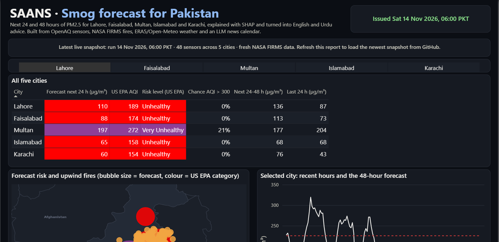

# SAANS in Power BI

The Power BI version of the SAANS dashboard. It shows the same forecasts, explanations and data-quality results as the [web dashboard](https://saansgit-uhebsjzld3rfqxupnygsop.streamlit.app/), from the same data.

## Open it

* **`SAANS.pbix`**: open in Power BI Desktop (free, Windows). The data is included, so it opens without internet or sign-in.
* **Newest data:** Home → **Refresh** loads the latest tables from this repository on GitHub (`powerbi/data`; about 10 minutes, mostly the cleaned hourly table). On the first refresh on a computer, Power BI asks how to access the web content: keep **Anonymous** and click **Connect**.
* **`SAANS.pbip`**: the same report as a Power BI Project, stored as readable text (model and report definitions) so changes are visible in Git. Open it the same way and click Refresh.

## Pages

| Page | What it shows |
|---|---|
| **Live forecast** | The latest live run: next-24-hour PM2.5 for all five cities coloured by US EPA category, a map of forecasts and recent fire detections, the selected city's last 4 days and 48-hour forecast with its 80% band, the SHAP drivers ("Why this forecast?"), a what-if slider for fewer upwind crop fires, and the English and Urdu health advisory |
| **Replay: test seasons** | The same view for any day of the two held-out smog seasons (2024-25, 2025-26), with what actually happened and the forecast error. Opens on Lahore, 6 November 2024 |
| **Model performance** | Skill against persistence by city and season, SHAP share of each driver group, error tables against both baselines, hazard-warning scores, and the fire-feature ablation |
| **Data quality** | Records received and kept per source, the sensor map, every cleaning step with before/after counts, and sensors kept or rejected |
| **Cleaned data** | The hourly master table (266,760 city-hours): choose a city and a period |
| **How it works** | Data, cleaning, models, explanations and limits in brief, with links |

## How it is built

| File | Role |
|---|---|
| `export_data.py` | Writes the report's tables (`data/*.csv`) from the project's outputs: forecasts for the 930 test-season days and the latest live run, SHAP drivers, what-if values, the hourly chart series, map points, evaluation and data-quality tables. The daily GitHub job re-runs it after each live forecast |
| `build_pbip.py` | Writes the Power BI project: the semantic model (tables, relationships, DAX measures) and the six report pages |
| `make_basemap.py` | Draws the map background from Natural Earth country borders |

**Data model.** `Issues` (one row per forecast time) and `Cities` filter `Forecasts` (one row per city and time), which filters `Drivers`, `WhatIf` and `Chart`. `MapPoints` follows `Issues` only, so the map always shows every city and the fires for the chosen time. The evaluation and data-quality tables stand alone. `Fire reduction` is a what-if parameter (0 to 100%).

## Notes

* Power BI shows precomputed forecasts and runs no model itself, like the web dashboard's snapshot mode. "Live" is the latest live run saved in the repository.
* The map is a scatter chart over a drawn basemap, so it works offline and without signing in (Power BI's Map visual is switched off by default, and Azure Maps needs a signed-in account).
* The live run includes fire detections only when NASA FIRMS answered it; the status line at the top of the Live page says which.
